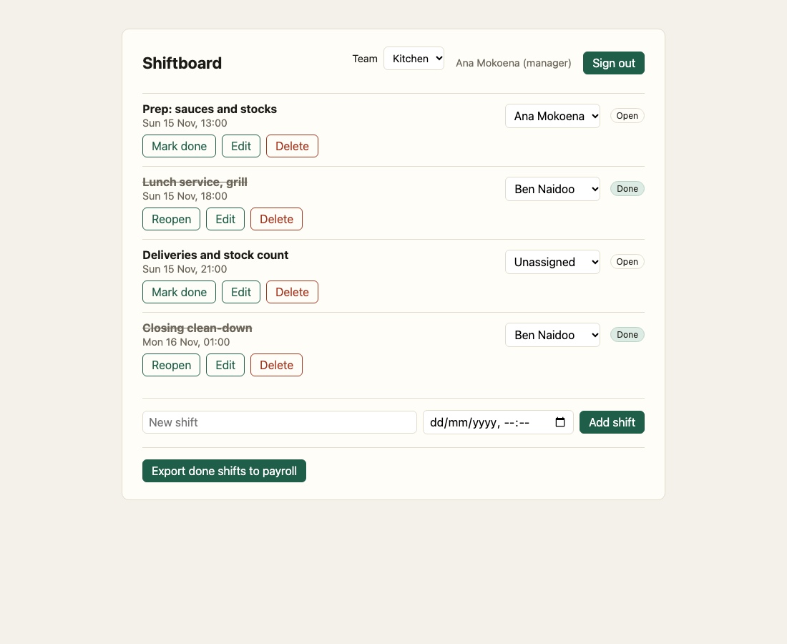

# Shiftboard casebook

A small, complete full-stack app (a team shift board) plus a casebook of seven failure cases, one for each layer a full-stack engineer ends up debugging: browser state, API contract, authorization, concurrent writes, query shape, an external integration, and deployment configuration.

Honest framing: these are reproduced failure cases in a lab app, written up the way a real incident is. They are not incidents from production systems. Each bug was seeded into working code on purpose, found by tracing a request end to end, fixed, and pinned with a regression test that I ran against the buggy commit to see it fail.



## What is in the app

- `web/`: Vite, React 18, TypeScript (strict), TanStack Query, Vitest and Testing Library, Playwright for end-to-end.
- `api/`: FastAPI, SQLAlchemy 2, Alembic, Pydantic v2, pytest. Cookie sessions with rotating refresh tokens, per-team roles, optimistic concurrency, a payroll export behind an interface with timeout, retry and an idempotency key.
- Contract: the OpenAPI document is committed, the web types are generated from it with `openapi-typescript`, and tests fail if either drifts.
- Default database is SQLite, so nothing but Python 3.11+ and Node 20+ is needed. No Docker.

Design notes are in [docs/ARCHITECTURE.md](docs/ARCHITECTURE.md) (component diagram, request lifecycle, data model). The checklist I use on generated patches is [docs/REVIEWING-AI-PATCHES.md](docs/REVIEWING-AI-PATCHES.md).

## Run it

```
make setup     # API virtualenv and web dependencies
make dev       # API on :8000, payroll stub on :9100, web on :5173
```

Open http://localhost:5173 and sign in as `ana@example.test` (manager of Kitchen), `ben@example.test` (Kitchen member) or `cara@example.test` (manager of Front of house). Password for all three: `shiftboard-demo`.

```
make lint      # ruff (check and format) and tsc
make test      # pytest, vitest, contract check, Playwright (headless Chromium, one worker)
make types     # regenerate api/openapi.json and web/src/api/schema.d.ts
make prove CASE=3   # show case 3's regression test fail on its seed commit and pass on its fix
```

`make test` installs Playwright's Chromium on first use. Only one browser process runs at a time.

## The cases

Each case lives in `cases/` with the same sections: Symptom, Reproduction, Trace (with the log lines, SQL and responses I captured), Root cause, Fix, Regression test, Review notes (what a plausible but wrong AI fix would do, and why it fails).

`git log` shows the trail: a `chore(case-N): seed ...` commit that introduces the bug while the suite stays green, then a `fix(case-N): ...` commit that carries the fix and the regression test.

| # | Layer | Root cause in one line | Seed | Fix |
|---|-------|------------------------|------|-----|
| [1](cases/01-stale-list-after-mutation.md) | Client state | The mutation invalidated a query key nothing subscribes to, so the list stayed stale | `31413c3` | `5aef53e` |
| [2](cases/02-api-contract-drift.md) | API contract | A response field was renamed with no contract gate; the client threw on an invalid date and rendered a blank page | `5a34593` | `877338c` |
| [3](cases/03-idor-on-shift-lookup.md) | Authorization | The shared shift lookup stopped scoping by team, so any user could read and edit any shift by id | `62f4898` | `48d1787` |
| [4](cases/04-lost-update.md) | Persistence | The version column was bumped but never compared, so the last concurrent writer silently won | `ab1cdf1` | `f62c2fe` |
| [5](cases/05-n-plus-one-in-the-list.md) | Persistence | Lost eager load made the list run one query per assignee | `4c95d90` | `89dff6a` |
| [6](cases/06-duplicate-payroll-batch.md) | Networking | A retry after a lost acknowledgement carried no idempotency key and created a second payroll batch | `3405f79` | `e464c8c` |
| [7](cases/07-cors-and-cookie-config.md) | Deployment | CORS origins and cookie flags were hardcoded, breaking split-origin sign-in and allowing any origin | `f0df6f6` | `8b5215e` |

`scripts/prove-case.sh` (and `make prove CASE=N`) checks out each seed commit in a temporary worktree, lays that case's regression test on top, runs it, then runs it on the fix. The selectors are in `cases/regression-tests.tsv`.

## Layout

```
api/            FastAPI app, Alembic migrations, tests, OpenAPI snapshot
web/            React client, Vitest suites, Playwright specs
cases/          the casebook
docs/           architecture and review checklist
scripts/        prove-case.sh
.github/        CI workflow (runs lint and make test once pushed)
```

## Known limits

- The suite runs on SQLite. The code is written to be portable to Postgres but that is not tested here.
- The concurrency test in case 4 exercises a real race with two threads; it is a check, not a proof.
- Two tabs refreshing a session at the same instant can trip refresh-token reuse detection and sign the user out; see the architecture notes.
- The payroll service is a local stub that behaves like an idempotent API. Real providers differ, so confirm their idempotency semantics before depending on this pattern.
- Case 2 and case 7 were demonstrated through HTTP responses and a headless browser run, not through a deployed split-origin environment.

## Related work

- [gs-code](https://github.com/Matthew-Klette/gs-code): TypeScript VS Code extension and CLI.
- [synthetic-crowd](https://github.com/Matthew-Klette/synthetic-crowd): Python tool for testing copy on independent LLM personas.
- [nishiki](https://github.com/Matthew-Klette/nishiki): React, TypeScript and Canvas.
- [Android-TeeUp](https://github.com/Matthew-Klette/Android-TeeUp): Kotlin, offline sync.

## Licence

MIT, see [LICENSE](LICENSE).
