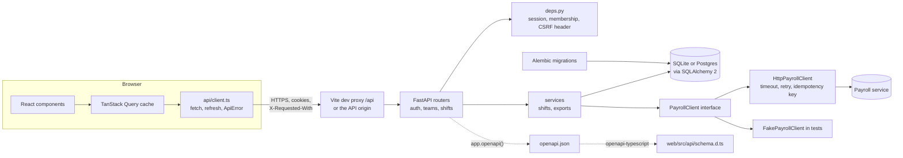
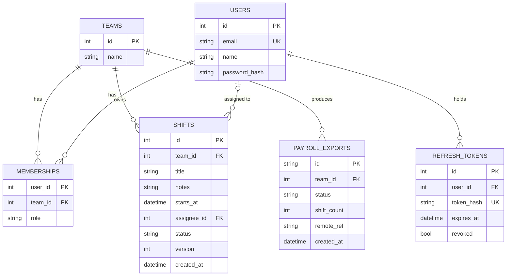

# Architecture

Shiftboard is a team shift board: people belong to teams, teams own shifts, managers export completed shifts to a payroll service.

## Components

The OpenAPI document is the contract. `api/openapi.json` is committed, `web/src/api/schema.d.ts` is generated from it, and two tests (`api/tests/test_contract.py`, `web/src/contract.test.ts`) fail if either drifts. See case 2.

## Request lifecycle: Mark done

1. `ShiftRow` calls `useUpdateShift(teamId).mutate({ id, body: { status: "done", version } })`.
2. `api.updateShift` sends `PATCH /api/shifts/100` with `credentials: "include"`, `Content-Type: application/json` and `X-Requested-With: shiftboard`.
3. Vite (development) strips `/api` and forwards to FastAPI. In a split-origin deployment the browser calls the API origin directly after a CORS preflight.
4. FastAPI runs `require_csrf_header`, then `current_user` (decodes the `access_token` cookie, loads the user; 401 if missing or expired).
5. `get_shift_for_user` loads the shift through a join on `memberships`, so another team's shift is a 404.
6. `update_shift` runs `UPDATE shifts SET ..., version = version + 1 WHERE id = ? AND version = ?`. Zero rows is a 409 with the current version (case 4).
7. The route returns `ShiftOut`. The client's `onSettled` invalidates `["teams", teamId, "shifts"]`, which triggers `GET /teams/{id}/shifts`, and the list re-renders (case 1).
8. If any call returned 401, `request()` runs one shared `POST /auth/refresh`, then retries the original call once. The refresh rotates the refresh token.

## Authentication and authorization

- `POST /auth/login` verifies a scrypt hash and sets two HttpOnly cookies: a 15 minute JWT access token and an opaque refresh token. The refresh token is stored as a SHA-256 hash.
- `POST /auth/refresh` revokes the presented refresh token and issues a new pair. Presenting an already revoked token revokes every session of that user (reuse detection).
- `POST /auth/logout` revokes the refresh token and clears both cookies.
- Authorization is per team. `Membership(user_id, team_id, role)` with roles `member` and `manager`. Team routes use the `team_membership` dependency; id-addressed routes load through `get_shift_for_user`. Non-members get 404 rather than 403 so ids cannot be probed (case 3).
- Cookies are not readable by scripts. Because browsers attach them automatically, every non-GET request must carry `X-Requested-With: shiftboard`; a cross-site form cannot set that header, and a cross-origin `fetch` that does is subject to the CORS preflight (case 7).

Known limitation: two browser tabs that refresh at the same instant can trip reuse detection and sign the user out. The client shares one refresh per tab; a short grace window for the previous token on the server would close the gap, and is not implemented.

## Data model

`shifts.version` is the optimistic-concurrency token. `payroll_exports.id` doubles as the idempotency key sent to payroll. Timestamps are stored as naive UTC and returned as timezone-aware UTC (`UTCDateTime` type), because SQLite drops time zones.

## Payroll integration

`PayrollClient` is a one-method interface. `HttpPayrollClient` posts to `/payroll/batches` with a per-phase timeout (default 2 s), up to 3 attempts, exponential backoff with jitter, a retry on timeouts, transport errors and 5xx, no retry on 4xx, and a stable `Idempotency-Key` (case 6). `FakePayrollClient` records calls for route tests. `payroll_stub.py` is a small local HTTP server used by `make dev`, by end-to-end tests and by the integration tests; it can stall after processing a request or hang entirely.

The export row is committed as `pending` before the network call and updated to `sent` or `failed` after it. A crash in between leaves a visible `pending` row, not a silent gap.

## Configuration

All environment-dependent behaviour is in `api/app/config.py` and validated at startup: database URL, secret key, CORS origins, cookie SameSite and Secure flags, payroll URL, timeout and retries. Migrations run at startup when `SHIFTBOARD_AUTO_MIGRATE` is on (the default); a test checks that the migrated schema matches the models. The default database is SQLite so the suite needs nothing installed beyond Python and Node; SQLAlchemy and Alembic keep the code portable to Postgres, which this repository does not test.

## Testing layout

- `api/tests`: pytest with FastAPI's TestClient and a temporary SQLite file per test.
- `web/src/**/*.test.tsx`: Vitest and Testing Library against an in-memory fake of the API (`web/src/test/fakeApi.ts`).
- `web/e2e`: Playwright, headless Chromium, one worker, against a real API, a real Vite server and the payroll stub.
- `scripts/prove-case.sh`: checks that each case's regression test fails on its seed commit and passes on its fix commit.
